# Complete Sinhala Vocabulary Encyclopedia — System Architecture & Specification

## 1. System Architecture Design

The **Complete Sinhala Vocabulary Encyclopedia** (*මහා සිංහල ශබ්දකෝෂ විශ්වකෝෂය / முழுமையான சிங்கள சொற்களஞ்சிய கலைக்களஞ்சியம்*) is an unbounded, production-grade linguistic preservation, learning, and research platform supporting **Sinhala (සිංහල)**, **Tamil (தமிழ்)**, and **English**.

```mermaid
flowchart TD
    subgraph Client["Frontend Web Application (React + TypeScript + Vite + Tailwind CSS)"]
        UI_Home["Homepage & Live Statistics"]
        UI_Search["Advanced Trilingual Search & Fuzzy Autocomplete"]
        UI_Explorer["9-Dimension Category & Sinhala Orthographic Explorer"]
        UI_Word["Dedicated Word Encyclopedia Page"]
        UI_Learn["Interactive Learning Suite (Flashcards, Quizzes, Fill-in-Blank, Audio)"]
        UI_Contribute["Community & Linguist Contribution Portal"]
        UI_Admin["Admin Dashboard, Research Job Monitor & Review Queue"]
    end

    subgraph Backend["Backend API & Orchestration Server (Node.js + Express + TypeScript)"]
        API_Vocab["Vocabulary & Search Controller"]
        API_Cat["Hierarchical Category Controller"]
        API_Learn["Learning & Spaced-Repetition Controller"]
        API_Contrib["Contribution & Moderation Controller"]
        API_Admin["Admin, Metrics & Audit Controller"]
        API_Auth["Role-Based JWT Auth (Admin, Reviewer, Contributor, Learner)"]
    end

    subgraph Queue["Background Job & Research Engine (BullMQ / Redis + PG Durable Queue)"]
        Scheduler["Scheduled Batch Orchestrator & Rate Limiter"]
        Pipeline["10-Stage AI Vocabulary Discovery & Verification Pipeline"]
        LLM_Adapter["Provider-Independent LLM Adapter (Gemini / OpenAI / Anthropic / Local / Rule-Verified)"]
        Corpus_Ingest["Permitted Corpus & Public-Domain Dictionary Ingestor"]
    end

    subgraph Storage["Scalable Relational Database (PostgreSQL 15+ UTF-8)"]
        PG_Core["Core Lexicon Tables (vocabulary_entries, senses, translations, pronunciations)"]
        PG_Ling["Linguistic Structure (word_forms, linguistic_roots, synonyms, antonyms)"]
        PG_Cat["Multi-Dimensional Taxonomy (categories, word_category_relations)"]
        PG_Source["Provenance & Audit (vocabulary_sources, entry_sources, audit_logs)"]
        PG_Workflow["Research & Moderation (research_jobs, agent_logs, review_queue, user_contributions)"]
        PG_Search["GIN Full-Text Search + pg_trgm Trigram Indexes + Sinhala Collation"]
    end

    Client <-->|REST JSON API| Backend
    Backend <--> Storage
    Backend <--> Queue
    Queue <--> Storage
    Pipeline <--> LLM_Adapter
    Pipeline <--> Corpus_Ingest
```

### Core Architectural Principles
- **Unbounded Scalability**: No artificial limits on vocabulary size. Designed with B-Tree, GIN (`tsvector`), and GiST/GIN (`pg_trgm`) indexes, cursor/offset pagination, and normalized multi-sense lexical modeling to scale seamlessly to hundreds of thousands of verified entries.
- **Strict Epistemic Honesty & Provenance**: Every entry tracks its `verification_status` (`VERIFIED`, `SOURCE_SUPPORTED`, `AI_SUGGESTION`, `UNVERIFIED`, `DISPUTED_OR_REGIONAL`), `confidence_score` (0.00–1.00), source citations, and full audit history. AI-generated candidates are never fabricated or conflated with verified lexical facts.
- **Provider-Independent AI Layer**: A clean `LLMProvider` interface supports Google Gemini, OpenAI, Anthropic, Ollama/OpenAI-compatible endpoints, and a deterministic corpus-backed linguistic analyzer when external API keys are not configured.
- **Dual-Mode Background Queue**: Uses **BullMQ + Redis** when `REDIS_URL` is available, and seamlessly falls back to a **PostgreSQL-backed durable transactional job worker** (`FOR UPDATE SKIP LOCKED`) with exponential backoff, rate limiting, and real-time stage logging when running in standalone environments.

---

## 2. Relational Database Schema (PostgreSQL)

All tables use UTF-8 (`NFC` normalized Sinhala and Tamil Unicode), relational foreign keys, and strict integrity constraints:

1. `users`: Role-based accounts (`ADMIN`, `LINGUIST_REVIEWER`, `CONTRIBUTOR`, `LEARNER`).
2. `vocabulary_entries`: Headword record (`id`, `sinhala_word`, `normalized_sinhala`, `sinhala_initial_letter`, `sinhala_sort_key`, `romanized_primary`, `part_of_speech`, `difficulty_level`, `register`, `spoken_vs_literary`, `regional_dialect`, `etymology_summary`, `verification_status`, `confidence_score`, `is_demo_seed`, `view_count`, `created_at`, `updated_at`).
3. `vocabulary_senses` (`definitions`): Supports multiple distinct meanings per Sinhala headword (`entry_id`, `sense_number`, `definition_si`, `definition_ta`, `definition_en`, `usage_context`, `domain_label`, `formality`).
4. `translations`: Context-dependent Tamil and English translations linked to entries and specific senses (`entry_id`, `sense_id`, `language_code` [`ta` | `en`], `translated_text`, `transliteration`, `context_note`, `is_primary`, `confidence_score`).
5. `pronunciations`: Phonetic representations (`entry_id`, `romanized_ipa`, `romanized_singlish`, `tamil_script_phonetic`, `syllable_breakdown`, `audio_url`, `dialect_region`).
6. `categories`: Hierarchical, dynamically expandable taxonomy across all 9 major dimensions (`id`, `slug`, `dimension`, `parent_id`, `name_si`, `name_ta`, `name_en`, `description_en`, `sort_order`, `is_system`).
7. `word_category_relations` (`word_categories`): Many-to-many mapping between `vocabulary_entries` and `categories` with `relevance_score` and `assigned_by`.
8. `example_sentences`: Trilingual contextual sentences (`entry_id`, `sense_id`, `sinhala_sentence`, `sinhala_romanized`, `tamil_sentence`, `english_sentence`, `context_type`, `formality`, `source_reference`).
9. `synonyms`: Directed/bidirectional synonym relationships (`entry_id`, `synonym_entry_id`, `synonym_sinhala_word`, `tamil_gloss`, `english_gloss`, `nuance_note`, `register_difference`).
10. `antonyms`: Antonym relationships (`entry_id`, `antonym_entry_id`, `antonym_sinhala_word`, `tamil_gloss`, `english_gloss`, `contrast_note`).
11. `related_words`: Derived, compound, collocated, or semantically related words (`entry_id`, `related_sinhala_word`, `relation_type`, `tamil_gloss`, `english_gloss`).
12. `word_forms`: Inflected and grammatical forms (`entry_id`, `form_type` [singular, plural, definite, indefinite, case form, present/past/future tense, participle, imperative, honorific], `sinhala_form`, `romanized_form`, `grammatical_notes`).
13. `linguistic_roots`: Etymological and root lineage (`entry_id`, `root_word`, `origin_language` [Elu/Indigenous Sinhala, Pali, Sanskrit, Tamil, Portuguese, Dutch, English, Malay], `historical_attestation`, `etymology_notes`, `cognates`).
14. `vocabulary_sources`: Registry of dictionaries, corpora, academic publications, and government glossaries (`id`, `source_code`, `title`, `author_or_institution`, `publication_year`, `license_type`, `url`, `reliability_tier`, `is_permitted`).
15. `entry_sources`: Many-to-many citation table linking `vocabulary_entries` to `vocabulary_sources` with `citation_detail` and `verified_at`.
16. `research_jobs`: Batch research job tracking (`id`, `job_name`, `job_type`, `target_domain`, `target_category_slug`, `status`, `batch_size`, `processed_count`, `discovered_count`, `verified_count`, `Queued_for_review_count`, `duplicate_count`, `failed_count`, `provider_used`, `config_json`, `error_message`, `started_at`, `completed_at`, `created_by`).
17. `agent_logs`: Granular stage-by-stage logs for every pipeline execution (`id`, `job_id`, `stage_number`, `stage_name`, `candidate_word`, `status`, `confidence_score`, `message`, `metadata_json`, `created_at`).
18. `review_queue`: Uncertain AI discoveries or disputed entries awaiting human linguist validation (`id`, `entry_id`, `job_id`, `candidate_payload`, `reason_for_review`, `confidence_score`, `status` [`PENDING`, `APPROVED`, `REJECTED`, `NEEDS_EDIT`], `reviewer_id`, `reviewer_notes`, `created_at`, `reviewed_at`).
19. `user_contributions`: Community submissions (`id`, `contribution_type` [`NEW_WORD`, `TRANSLATION_CORRECTION`, `REGIONAL_VARIANT`, `EXAMPLE_SENTENCE`, `ERROR_REPORT`, `SOURCE_REFERENCE`], `target_entry_id`, `contributor_name`, `contributor_email`, `contributor_role`, `payload_json`, `source_citation`, `status`, `moderator_notes`, `created_at`, `reviewed_at`).
20. `audit_logs`: Immutable history of all modifications and verifications (`id`, `entity_type`, `entity_id`, `action`, `actor`, `previous_state`, `new_state`, `reason`, `created_at`).
21. `user_learning_progress`: Personal vocabulary lists & flashcard mastery tracking (`id`, `session_key`, `entry_id`, `is_bookmarked`, `mastery_level`, `correct_streak`, `last_practiced_at`).

---

## 3. Multi-Stage AI Research & Verification Pipeline (10 Stages)

Every candidate word processed by the autonomous research agent passes through 10 explicit, logged stages:

- **Stage 1 — Word Discovery**: Harvests candidate headwords from permitted corpora, public-domain lexicons (e.g., Carter's 1924 Sinhalese-English Dictionary, Clough's 1892 Dictionary, Official Languages Department Trilingual Glossaries), or domain seed lists.
- **Stage 2 — Sinhala Spelling & Unicode Verification**: Normalizes Unicode to `NFC`, validates Sinhala script codepoints (`U+0D80`–`U+0DFF`), checks Zero-Width Joiner (`U+200D`) sequences for *rakaransaya* (`්‍ර`) and *yansaya* (`්‍ය`), and verifies *Nasal/Murdhaja/Dantaja* (`ණ/න`, `ළ/ල`, `ශ/ෂ/ස`) orthography rules.
- **Stage 3 — Linguistic & Grammatical Classification**: Identifies part of speech, animate/inanimate gender class, stem inflection class, register (spoken vs. literary), and morphological structure (root, plural, verb conjugation).
- **Stage 4 — Tamil Translation & Phonetic Transliteration**: Produces context-sensitive Tamil translations (`தமிழ்`) and Tamil script phonetic guides for Sinhala pronunciation.
- **Stage 5 — English Translation & Romanization**: Produces accurate English meanings, ISO-15919 / scholarly Romanization, and intuitive Singlish pronunciation.
- **Stage 6 — Contextual Meaning & Example Verification**: Generates/validates trilingual example sentences (Sinhala, Tamil, English) across formal and informal contexts and assigns the 9-dimensional category taxonomy.
- **Stage 7 — Duplicate & Variant Detection**: Checks normalized Sinhala forms, Romanized forms, and trigram similarity against `vocabulary_entries` to detect exact duplicates or orthographic variants.
- **Stage 8 — Source & Citation Verification**: Links the candidate entry to documented `vocabulary_sources` and computes source reliability weight.
- **Stage 9 — Confidence Scoring**: Computes a composite `confidence_score` (0.00–1.00) based on Unicode validity, source tier, translation cross-check, and morphological completeness.
- **Stage 10 — Routing & Human Review Gate**:
  - Entries with `confidence_score >= 0.85` and verified source citations are saved as `SOURCE_SUPPORTED` or `VERIFIED` (when corroborated by multiple authoritative sources or human reviewer).
  - Entries with `0.55 <= confidence_score < 0.85` or single-AI-source status are flagged as `AI_SUGGESTION` / `UNVERIFIED` and automatically inserted into `review_queue` for human linguist sign-off.

---

## 4. Nine-Dimensional Hierarchical Category Taxonomy

The taxonomy supports dynamic expansion and multi-category tagging across all 9 dimensions:
- **A. Part of Speech (`PART_OF_SPEECH`)**: Nouns, Proper nouns, Pronouns, Verbs, Adjectives, Adverbs, Prepositions and postpositions, Conjunctions, Interjections, Particles, Auxiliary verbs, Numerals, Classifiers, Other grammatical categories.
- **B. Everyday Purpose (`EVERYDAY_PURPOSE`)**: Greetings, Introductions, Asking questions, Answering questions, Requesting something, Giving instructions, Agreeing, Disagreeing, Apologizing, Thanking, Expressing emotions, Expressing opinions, Giving directions, Describing people, Describing objects, Describing situations, Making conversations.
- **C. Location and Environment (`LOCATION_ENVIRONMENT`)**: Home, Kitchen, Bedroom, Bathroom, University, School, Classroom, Library, Office, Workplace, Hospital, Pharmacy, Restaurant, Hotel, Shopping mall, Market, Bus station, Railway station, Airport, Bank, Police station, Government office, Temple, Village, City, Countryside, Agricultural environments, Industrial environments, Natural environments.
- **D. Subject and Knowledge Domain (`SUBJECT_DOMAIN`)**: Mathematics, Physics, Chemistry, Biology, Computer science, Information technology, Artificial intelligence, Engineering, Medicine, Anatomy, Psychology, Sociology, Economics, Business, Accounting, Law, Politics, Geography, Astronomy, Agriculture, Architecture, Automobile, Telecommunications, Education, History, Literature, Art, Music, Sports, Religion and philosophy, Environmental science.
- **E. Human Life and Activities (`HUMAN_LIFE`)**: Family relationships, Body parts, Food and beverages, Clothing, Personal hygiene, Health, Education, Employment, Transportation, Travel, Money and finance, Shopping, Entertainment, Relationships, Marriage, Social interactions, Daily routines, Household activities, Exercise and fitness, Technology usage.
- **F. Grammar and Linguistic Structure (`GRAMMAR_STRUCTURE`)**: Singular and plural, Verb conjugations, Tenses, Gender and grammatical classifications, Case forms, Inflections, Compound words, Derived words, Root words, Prefixes and suffixes, Idioms, Proverbs, Phrasal expressions, Colloquial expressions, Formal expressions, Literary vocabulary.
- **G. Vocabulary Difficulty (`DIFFICULTY_LEVEL`)**: Beginner, Elementary, Intermediate, Upper intermediate, Advanced, Native-level, Academic, Specialized terminology.
- **H. Communication Situation (`COMMUNICATION_SITUATION`)**: Casual conversations, Formal conversations, Academic discussions, Professional communication, Business meetings, University conversations, Public speaking, Telephone conversations, Emergency situations, Customer service, Interviews, Social media.
- **I. Specialized Collections (`SPECIALIZED_COLLECTION`)**: Traditional Sinhala words, Ancient Sinhala vocabulary, Modern Sinhala vocabulary, Rare words, Regional dialects, Slang, Loanwords, Sanskrit-derived vocabulary, Pali-derived vocabulary, Tamil-derived vocabulary, Portuguese-derived vocabulary, Dutch-derived vocabulary, English-derived vocabulary, Technical terminology, Scientific terminology, Literary words, Onomatopoeia, Animal names, Plant names, Insect names, Bird names, Fish names, Medicinal plants.

---

## 5. REST API Endpoints

- `GET /api/health` — System health, PostgreSQL status, queue engine status, and LLM provider status.
- `GET /api/stats` — Comprehensive encyclopedia metrics (total entries, verified vs. source-supported vs. AI suggestion vs. unverified, counts by dimension, POS, difficulty, source, recent additions, daily featured word).
- `GET /api/vocabulary` — Advanced search & filter endpoint (`q`, `lang`, `pos`, `category`, `dimension`, `difficulty`, `status`, `register`, `letter_si`, `letter_roman`, `origin`, `sort`, `page`, `limit`). Supports Sinhala script, Tamil script, English, Romanized pronunciation, partial match, fuzzy trigram similarity, and spelling suggestions.
- `GET /api/vocabulary/autocomplete` — Sub-50ms trilingual autocomplete with fuzzy suggestions.
- `GET /api/vocabulary/alphabet` — Returns Sinhala orthographic letter counts (`අ` to `ෆ` in authentic Sinhala alphabetical order) and Romanized `A`–`Z` counts.
- `GET /api/vocabulary/:idOrWord` — Full encyclopedia entry dossier (headword, senses, translations, pronunciations, trilingual examples, word forms, etymology/roots, synonyms, antonyms, related words, categories, source citations, audit log).
- `GET /api/categories` — Full 9-dimension hierarchical tree with word counts per category and subcategory.
- `POST /api/categories` — Dynamically create a new category or subcategory.
- `GET /api/learning/deck` — Fetch flashcards, Sinhala-to-Tamil, Sinhala-to-English, multiple-choice quizzes, fill-in-the-blank, and listening/pronunciation exercises filtered by category or difficulty.
- `POST /api/learning/progress` — Save bookmark or quiz/flashcard mastery state.
- `GET /api/learning/progress/:sessionKey` — Retrieve personal vocabulary list and learning statistics.
- `GET /api/contributions` / `POST /api/contributions` — Submit and view community contributions (new words, translation corrections, regional variants, example sentences, error reports, references).
- `GET /api/admin/overview` — Admin dashboard telemetry, duplicate detection reports, coverage gaps, verification breakdown, and source distribution.
- `GET /api/admin/research-jobs` / `POST /api/admin/research-jobs` — List research jobs, launch new autonomous AI discovery batch jobs, or retry failed jobs.
- `GET /api/admin/research-jobs/:id/logs` — Inspect stage-by-stage 10-stage pipeline logs for a research job.
- `GET /api/admin/review-queue` / `POST /api/admin/review-queue/:id/decision` — Approve, edit-and-approve, or reject items in the human review queue.
- `POST /api/admin/contributions/:id/moderate` — Approve or reject user contributions and automatically merge verified updates into `vocabulary_entries`.

---

## 6. Permitted Data Sources & Licensing Policy

All seeded and agent-discovered vocabulary strictly adheres to open/permitted linguistic sources:
1. **Charles Carter's *A Sinhalese-English Dictionary* (1924)** — Public Domain.
2. **Rev. Benjamin Clough's *A Sinhalese-English Dictionary* (1892)** — Public Domain.
3. **Department of Official Languages, Sri Lanka — Trilingual Glossaries (Sinhala-Tamil-English)** — Public Government Linguistic Resource.
4. **Educational Publications Department (Sri Lanka) Technical & Academic Glossaries** — Public Educational Terminology Reference.
5. **Pali Text Society & Classical Elu/Sanskrit Etymological References** — Public Domain Philological Reference.
6. **Verified Community & Linguist Contributions** — Licensed under CC BY-SA 4.0 with contributor attribution.

---

## 7. Implementation Roadmap

- **Phase 1**: Database Schema, Migrations, Sinhala Orthographic Collation, and Trigram/Full-Text Search Indexes.
- **Phase 2**: Authentic Demonstration Dataset Seeding (Richly annotated trilingual Sinhala-Tamil-English lexicon across all 9 dimensions, clearly marked with provenance, etymology, inflections, synonyms/antonyms, and example sentences).
- **Phase 3**: Backend API Server, Provider-Independent LLM Adapter, and 10-Stage Autonomous Vocabulary Research Agent with BullMQ/PG Job Queue.
- **Phase 4**: Frontend Web Application (Homepage, Advanced Trilingual Search with Fuzzy Suggestions, 9-Dimension Category & Sinhala Alphabet Explorer, Dedicated Word Encyclopedia View, Interactive Learning Center, Community Contribution Portal, and Admin & Agent Operations Center).
- **Phase 5**: Automated Testing, Documentation, Backup/Recovery Scripts, Docker Configuration, and Git Repository Synchronization.
